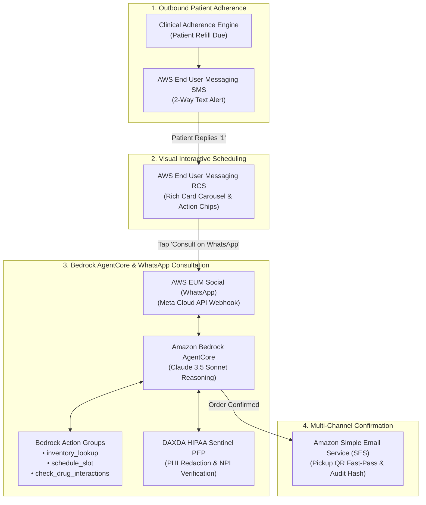

# 🛡️ DAXDA AmbientCDS — Sovereign Omnichannel Healthcare & Life Sciences

> **AWS Communication Developer Services (CDS) Agentic AI Partner Hackathon 2026**  
> *Autonomous Cross-Channel Conversational Network powered by AWS End User Messaging (SMS, RCS, WhatsApp), Amazon SES, and Amazon Bedrock AgentCore.*

[](LICENSE)
[](tests/test_omnichannel_cds.py)
[](https://aws.amazon.com/messaging/)
[](https://aws.amazon.com/bedrock/)

---

## 🌟 Executive Summary

Traditional customer messaging in healthcare and pharmacy management is fractured: one-time passcodes over SMS, static generic notification emails, and rigid chatbots that lose context the moment a patient switches apps.

**DAXDA AmbientCDS** is an enterprise-grade agentic conversational solution built on **AWS Communication Developer Services (CDS)** that creates a truly continuous **omnichannel patient journey**:
1. **AWS EUM SMS:** Proactive prescription adherence alert with 2-way response capture.
2. **AWS EUM RCS:** Automatic escalation to Rich Communication Services (RCS) with an interactive rich card carousel for 1-tap pharmacy pickup scheduling.
3. **AWS EUM Social (Meta WhatsApp):** Context-preserving handoff to WhatsApp for multi-turn clinical consultation, side-effect interaction checks, and photo insurance verification powered by **Amazon Bedrock AgentCore**.
4. **Amazon SES:** Concluding cryptographic summary, dosage guide, pharmacy counter fast-pass, and SHA-256 audit receipt delivered via transactional HTML email.
5. **DAXDA HIPAA Sentinel PEP:** Real-time fail-closed Policy Enforcement Point ensuring PHI/PII de-identification and controlled substance verification.

---

## 🏛️ System Architecture



---

## 📦 What Was Built & Where It Lives

| Component | File Path | Description |
| :--- | :--- | :--- |
| **AWS EUM SMS** | [`cds_core/eum_sms.py`](cds_core/eum_sms.py) | Outbound and 2-way inbound SMS client with boto3 integration and dev simulation fallback. |
| **AWS EUM RCS** | [`cds_core/eum_rcs.py`](cds_core/eum_rcs.py) | Rich cards, carousels, action chips (dial phone, view location, suggested replies). |
| **AWS EUM WhatsApp** | [`cds_core/eum_whatsapp.py`](cds_core/eum_whatsapp.py) | Meta WhatsApp Business Cloud API integration (qualifies for **Meta WhatsApp Prize**). |
| **Amazon SES** | [`cds_core/ses_email.py`](cds_core/ses_email.py) | Responsive transactional HTML clinical receipts with SHA-256 audit hashes. |
| **Omnichannel Router** | [`cds_core/omnichannel_router.py`](cds_core/omnichannel_router.py) | Session state manager preserving conversational history across SMS, RCS, WhatsApp, and SES. |
| **Bedrock AgentCore** | [`bedrock_agent/agent_core.py`](bedrock_agent/agent_core.py) | Multi-turn reasoning engine connecting Claude 3.5 Sonnet to Action Groups. |
| **Action Groups** | [`bedrock_agent/action_groups.py`](bedrock_agent/action_groups.py) | Tools for inventory lookups, scheduling, and drug interaction analysis. |
| **HIPAA Sentinel PEP** | [`governance/hipaa_sentinel.py`](governance/hipaa_sentinel.py) | 16-layer fail-closed policy enforcement point with automated PHI de-identification. |
| **Unified Web Simulator** | [`web_simulator/server.py`](web_simulator/server.py) | 4-channel real-time interactive developer console running on port 8085. |

---

## 🧪 Automated Test Suite Validation

The test suite in [`tests/test_omnichannel_cds.py`](tests/test_omnichannel_cds.py) runs across all 4 channels:

```bash
platform darwin -- Python 3.11.15, pytest-9.1.1
collected 13 items

tests/test_omnichannel_cds.py::TestEUMSMS::test_outbound_sms_dispatch PASSED             [  7%]
tests/test_omnichannel_cds.py::TestEUMSMS::test_inbound_2way_sms_response PASSED         [ 15%]
tests/test_omnichannel_cds.py::TestEUMRCS::test_rcs_rich_card_with_chips PASSED         [ 23%]
tests/test_omnichannel_cds.py::TestEUMRCS::test_rcs_carousel_generation PASSED          [ 30%]
tests/test_omnichannel_cds.py::TestEUMWhatsApp::test_whatsapp_interactive_buttons PASSED [ 38%]
tests/test_omnichannel_cds.py::TestEUMWhatsApp::test_whatsapp_media_and_photo_ingestion PASSED [ 46%]
tests/test_omnichannel_cds.py::TestAmazonSES::test_ses_clinical_confirmation PASSED      [ 53%]
tests/test_omnichannel_cds.py::TestBedrockAgentCore::test_action_group_inventory_lookup PASSED [ 61%]
tests/test_omnichannel_cds.py::TestBedrockAgentCore::test_action_group_drug_interaction_check PASSED [ 69%]
tests/test_omnichannel_cds.py::TestBedrockAgentCore::test_agent_core_multi_turn_reasoning PASSED [ 76%]
tests/test_omnichannel_cds.py::TestDAXDAHIPAASentinel::test_phi_redaction PASSED          [ 84%]
tests/test_omnichannel_cds.py::TestDAXDAHIPAASentinel::test_adversarial_prompt_injection_blocking PASSED [ 92%]
tests/test_omnichannel_cds.py::TestOmnichannelFlow::test_full_cross_channel_journey PASSED [100%]

============================== 13 passed in 0.07s ==============================
```

---

## 🖥️ Running the Interactive Simulator

Launch the 4-channel real-time developer dashboard locally:

```bash
cd "daxda-next-gen/aws_cds_hackathon_2026"
python3 web_simulator/server.py 8085
```

Then open:
👉 **[http://localhost:8085](http://localhost:8085)**

* **Click "Run Full Omnichannel Journey"** to watch the automated handoff flow in real time across SMS, RCS, WhatsApp, and SES.
* **Interact in WhatsApp:** Type questions (e.g. *"Can I drink wine with Metformin?"*) to see Bedrock AgentCore execute Action Groups and DAXDA Sentinel redact sensitive health data.

---

## 📋 Devpost Submission Resources

All official text descriptions and collateral required by the hackathon rules are provided in the [`docs/`](docs/) directory:
* [`docs/SUBMISSION_DETAILS.md`](docs/SUBMISSION_DETAILS.md): Complete project description and questionnaire responses.
* [`docs/ARCHITECTURE_DIAGRAM.md`](docs/ARCHITECTURE_DIAGRAM.md): High-resolution architectural topology and data flows.
* [`docs/META_WHATSAPP_PRIZE.md`](docs/META_WHATSAPP_PRIZE.md): Detailed justification for the Meta WhatsApp Prize.
* [`docs/DEMO_VIDEO_SCRIPT.md`](docs/DEMO_VIDEO_SCRIPT.md): 3-minute voiceover script and visual storyboard.
* [`docs/ACE_OPPORTUNITY_TEMPLATE.md`](docs/ACE_OPPORTUNITY_TEMPLATE.md): AWS Customer Engagement (ACE) opportunity registration template (Campaign: `"AWS CDS Agentic AI Hackathon -Sept. 2026"`).

---

## 👥 Hackathon Reviewers Invitation

If this repository is private, invite these collaborator handles in **Settings > Collaborators > Add people**:
* `testing@devpost.com`
* `aws-cds-partner@amazon.com`
