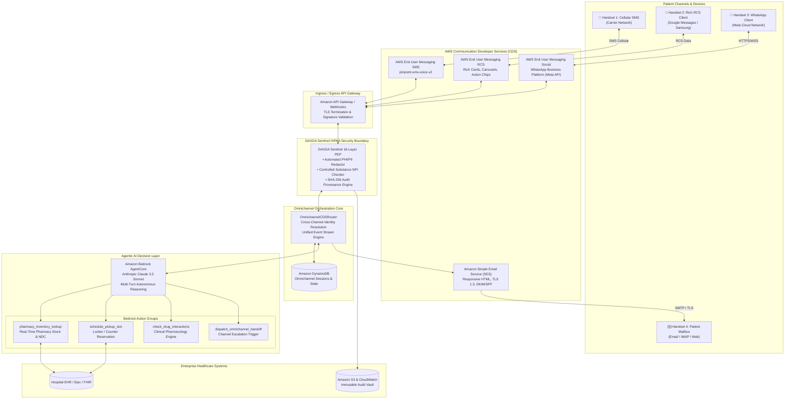
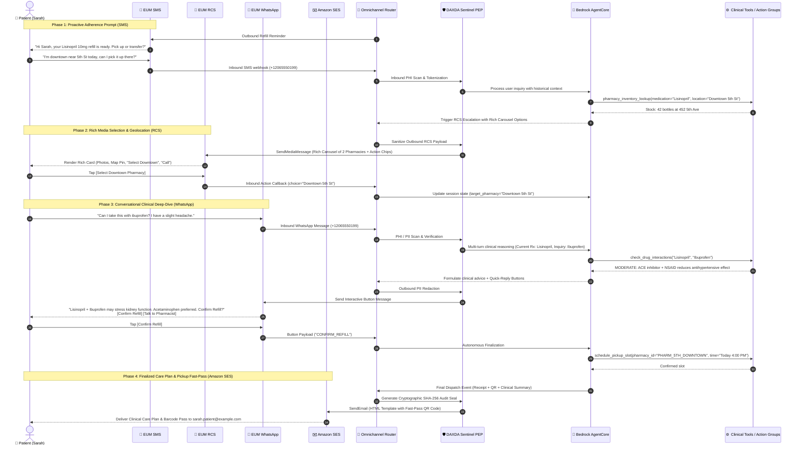

# System Architecture & Technical Specifications

**Project**: DAXDA CareFlow CDS  
**Hackathon**: AWS Communication Developer Services (CDS) Agentic AI Partner Hackathon  
**Document**: Architecture Topology, Data Flows, and Sequence Specifications  

---

## 1. High-Level Architecture Topology

The following diagram illustrates the complete end-to-end cloud topology of DAXDA CareFlow CDS, linking patient client endpoints, AWS Communication Developer Services, the Omnichannel Router, DAXDA Sentinel Governance, and Amazon Bedrock AgentCore:



---

## 2. End-to-End Cross-Channel Sequence Flow

The following sequence diagram details the full cross-channel handoff workflow, showing how conversational state is preserved seamlessly across SMS, RCS, WhatsApp, and SES:



---

## 3. Core Component Specifications

### 3.1 Omnichannel Session Orchestrator (`OmnichannelCDSRouter`)
- **Session Identification**: Combines E.164 phone numbers (`+12065550199`) and verified email addresses (`sarah.patient@example.com`) into a unified `patient_id`.
- **Event Sourcing**: Rather than maintaining fragile state flags, all user actions, inbound texts, outbound carousels, button clicks, and action group outputs append to an immutable `event_stream`.
- **Channel Switching Engine**: Evaluates payload type and context to select the most cost-effective and engaging CDS channel:
  - Text prompts ➔ **SMS**
  - Multi-option comparisons / maps ➔ **RCS**
  - Clinical discussions / rich interactive flows ➔ **WhatsApp**
  - Formal receipts / clinical summaries / legal disclosures ➔ **SES**

### 3.2 Amazon Bedrock AgentCore
- **Foundation Model**: `anthropic.claude-3-5-sonnet-20241022-v2:0`
- **Inference Mode**: Multi-turn dialogue with memory buffer and tool use.
- **Action Group Schemas**:
  1. `pharmacy_inventory_lookup(medication, dosage, zip_code, radius_miles)`
  2. `schedule_pickup_slot(patient_id, pharmacy_id, slot_time, medication)`
  3. `check_drug_interactions(primary_drug, proposed_drug)`
  4. `dispatch_omnichannel_handoff(target_channel, reason, payload_preview)`

### 3.3 DAXDA Sentinel HIPAA Security Boundary
The DAXDA Sentinel Policy Enforcement Point (PEP) operates under a **Zero-Trust, Fail-Closed** paradigm:
- **SSN & Financial Masking**: Pattern recognition redacting `XXX-XX-XXXX` and standard credit card formats (`(?:\d{4}[- ]?){3}\d{4}`).
- **Controlled Substance NPI Gating**: Checks medications against DEA Schedule II-V lists. If detected without an authorized prescriber NPI, the booking is held for manual clinician verification.
- **Audit Provenance Engine**: Computes SHA-256 digests over:
  ```
  Digest = SHA256(SessionID + Timestamp + Channel + InboundPayload + OutboundPayload + Salt)
  ```
  Logged synchronously to Amazon CloudWatch and cold-vaulted in Amazon S3 Object Lock for 7 years.

---

## 4. AWS Services & Implementation Matrix

| AWS Service | Role in DAXDA CareFlow CDS | API / SDK Methods Used |
| :--- | :--- | :--- |
| **AWS End User Messaging SMS** | High-throughput outbound adherence triggers & inbound conversational replies | `boto3.client('pinpoint-sms-voice-v2')`<br/>`send_text_message()` |
| **AWS End User Messaging RCS** | Rich cards, 3-card carousels, action chips (`OPEN_URL`, `DIAL_PHONE`, `VIEW_LOCATION`) | `boto3.client('pinpoint-sms-voice-v2')`<br/>`send_media_message()` |
| **AWS End User Messaging Social** | WhatsApp Business Platform integration: interactive buttons, photo intake, two-way dialog | Meta Graph API via AWS EUM Social webhook endpoints |
| **Amazon Simple Email Service (SES)** | Responsive HTML clinical receipts, pickup fast-pass codes, QR codes, HIPAA disclosures | `boto3.client('sesv2')`<br/>`send_email()` |
| **Amazon Bedrock AgentCore** | Autonomous agentic reasoning, intent extraction, tool calling, conversational memory | `boto3.client('bedrock-agent-runtime')`<br/>`invoke_agent()` |
| **Amazon DynamoDB** | Low-latency omnichannel session store and cross-channel message buffer | `boto3.resource('dynamodb')` |
| **Amazon CloudWatch & S3** | Cryptographic audit logging and HIPAA compliance retention | CloudWatch Logs & S3 Object Lock |

---

## 5. Security, Privacy & Compliance Architecture

```
+-------------------------------------------------------------------------+
|                  ENTERPRISE ZERO-TRUST SECURITY PERIMETER               |
|                                                                         |
|   +-----------------------+                 +-----------------------+   |
|   |   In Transit:         |                 |   At Rest:            |   |
|   |   • TLS 1.3 Strict    |                 |   • AWS KMS (CMK)     |   |
|   |   • Mutual TLS (mTLS) |                 |   • AES-256-GCM       |   |
|   |   • API HMAC-SHA256   |                 |   • S3 Object Lock    |   |
|   +-----------------------+                 +-----------------------+   |
|                                                                         |
|   +-----------------------------------------------------------------+   |
|   |              DAXDA 16-Layer Sentinel Policy Engine              |   |
|   |   Layer 1-4:   Regex & Token-Level PHI Redactor                |   |
|   |   Layer 5-8:   Controlled Substance NPI Prescriber Gate        |   |
|   |   Layer 9-12:  Cross-Channel Session Nonce Verification        |   |
|   |   Layer 13-16: SHA-256 Audit Seal & Compliance Archival         |   |
|   +-----------------------------------------------------------------+   |
+-------------------------------------------------------------------------+
```
