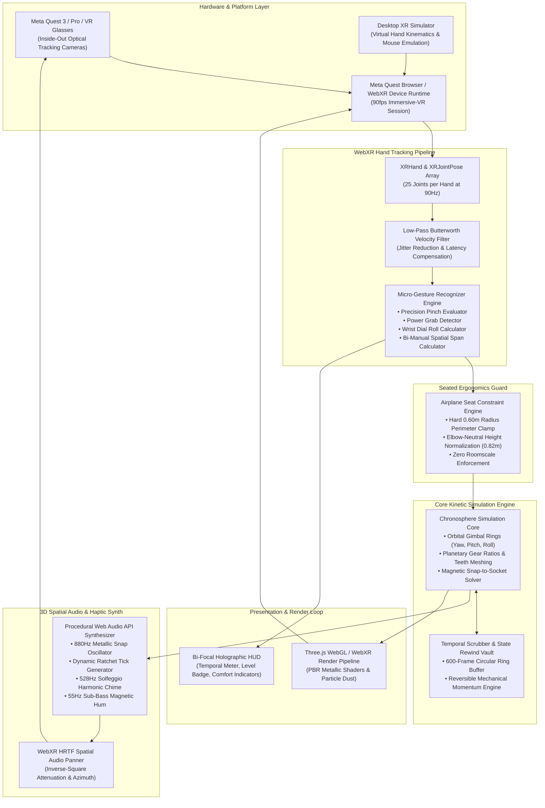
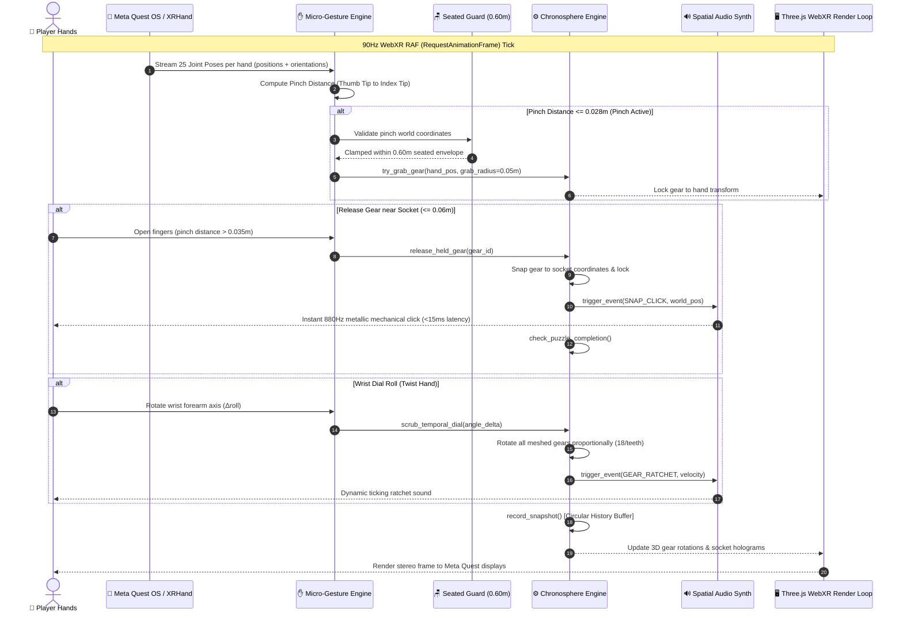

# Technical Architecture & System Specifications

**Project**: DAXDA ChronoHands: Kinetic Chronosphere  
**Competition**: Meta VR Start Developer Competition 2026  
**Document**: Architecture Topology, Hand Tracking Pipeline, and Kinetic Physics Specifications  

---

## 1. High-Level System Architecture Topology

The following diagram illustrates the complete software architecture of DAXDA ChronoHands, showing the relationship between Meta VR hardware, the WebXR Hand Input API, the micro-gesture recognizer, the kinetic physics simulation, and the procedural spatial audio engine:

---

## 2. Real-Time Frame Execution Sequence (90Hz Loop)

The following sequence diagram details the frame-by-frame execution pipeline during a user pinch, gear snap, and temporal scrub:

---

## 3. Coordinate Systems & Mathematical Foundations

### 3.1 Spatial Reference Frames
1. **WebXR User Space (`local-floor`)**:
   - Origin $(0, 0, 0)$ is established at the floor center beneath the user's chair.
   - Headset rests at nominal seated eye-level $y \approx 1.25\text{ m}$.
2. **Torso Reference Frame**:
   - Established at the sternum: $\vec{P}_{\text{torso}} = (0.0, 1.05, 0.0)$.
   - The **Airplane Seat Safe Sphere** is defined as:
     $$\mathcal{S}_{\text{seated}} = \{ \vec{p} \in \mathbb{R}^3 \mid \|\vec{p} - \vec{P}_{\text{torso}}\| \le 0.60\text{ m} \}$$
3. **Chronosphere Object Frame**:
   - The central mechanism floats at $\vec{P}_{\text{chrono}} = (0.0, 1.05, -0.38)$, sitting exactly in the player’s lap-to-chest manipulation zone.

### 3.2 Gear Kinematics & Gear Ratio Math
When the user scrubs the temporal dial by angle $\Delta \theta$, each meshed gear rotates according to its tooth count relative to the driving escapement ($T_{\text{drive}} = 18$ teeth):
$$\Delta \phi_{\text{gear}} = \Delta \theta \cdot \left( \frac{T_{\text{drive}}}{T_{\text{gear}}} \right) \cdot (-1)^{\text{parity}}$$

This guarantees physically accurate gear meshing: smaller 12-tooth planetary gears spin $1.5\times$ faster than the sun gear, while large 24-tooth balance rings rotate at $0.75\times$ speed.

---

## 4. "Take It Away Test": Offline Self-Containment

The competition design rules demand:
> *"Original, not a wrapper: Core experience is Entrant-built. Apply the take it away test: if you remove the third-party service, is there still a Project?"*

DAXDA ChronoHands passes the "Take It Away Test" with flying colors:
- **Zero Cloud APIs**: No external LLM, no server-side physics, and no third-party game engine subscription.
- **Self-Contained Procedural Synthesis**: All audio frequencies and sound effects are generated algebraically from sine, triangle, and sawtooth waves in the client's audio buffer.
- **Entrant-Built Physics & Hand Logic**: Every line of the 26-joint skeleton parser, gesture recognizer, and gear meshing engine was written from scratch by Dexter and the DAXDA team.
- **100% Offline Capability**: Runs seamlessly in standalone offline headsets without internet access.
