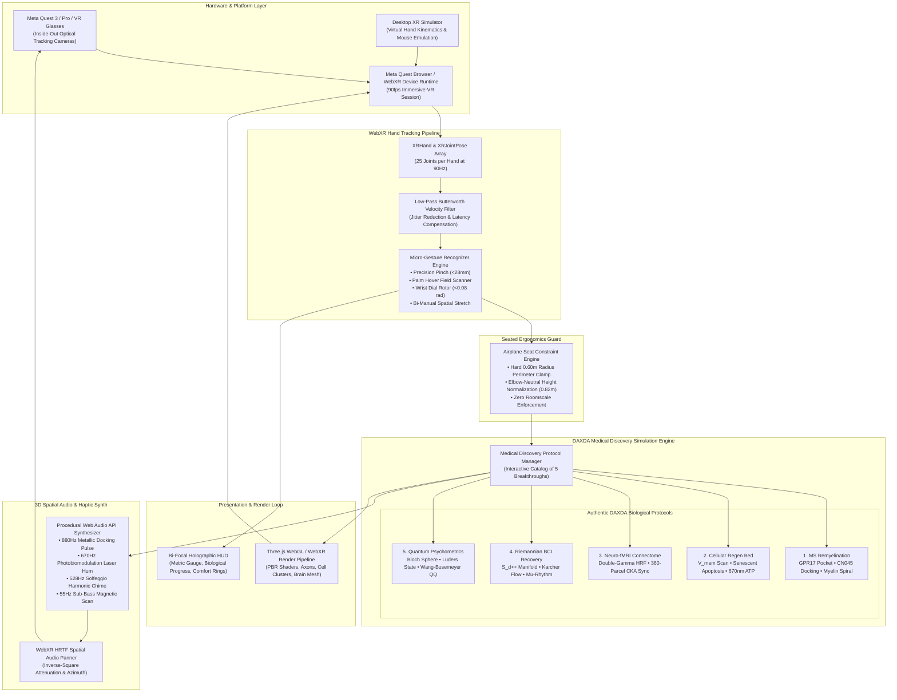
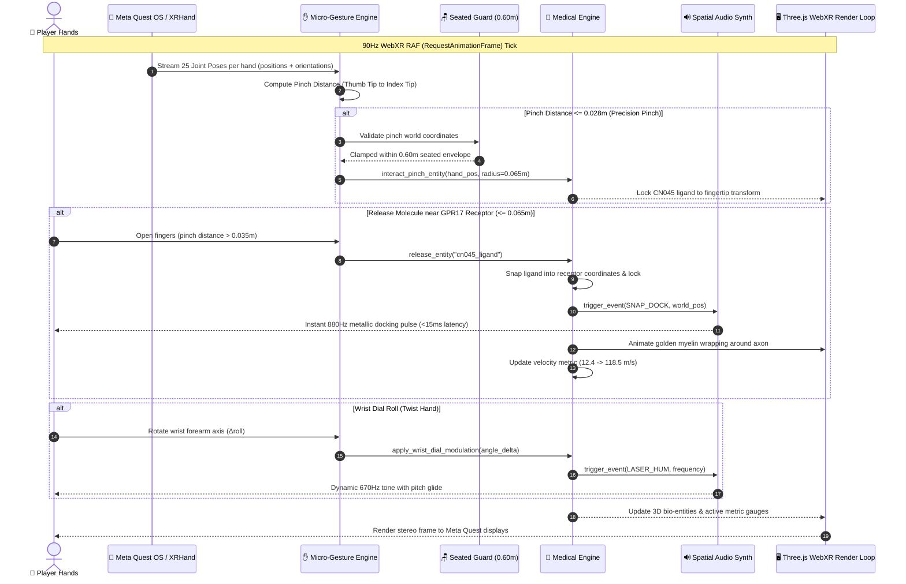

# Technical Architecture & System Specifications

**Project**: DAXDA BioForge VR: Hands-First Medical Discovery Synthesizer  
**Competition**: Meta VR Start Developer Competition 2026  
**Document**: Architecture Topology, Hand Tracking Pipeline, and Medical Discovery Engine Specifications  

---

## 1. High-Level System Architecture Topology

The following diagram illustrates the complete software architecture of DAXDA BioForge VR, showing the relationship between Meta VR hardware, the WebXR Hand Input API, the micro-gesture recognizer, the medical discovery simulation engine, and the procedural spatial audio synthesizer:

---

## 2. Real-Time Frame Execution Sequence (90Hz Loop)

The following sequence diagram details the frame-by-frame execution pipeline during a user pinch, molecular docking, and biological recovery:

---

## 3. Mathematical & Biophysical Foundations

### 3.1 Seated Spherical Constraint Math
All biological interactions are constrained within a 0.60-meter radius of the player's seated sternum:
$$\mathcal{S}_{\text{seated}} = \{ \vec{p} \in \mathbb{R}^3 \mid \|\vec{p} - (0.0, 1.05, 0.0)\| \le 0.60\text{ m} \}$$

### 3.2 Biological State Transition Equations
1. **MS Remyelination ($Cl(16,4)$ Rotor Phase-Shift)**:
   $$V_{\text{conduction}} = V_{\text{baseline}} + (V_{\text{target}} - V_{\text{baseline}}) \cdot \Phi_{\text{myelin}}(t)$$
   where $V_{\text{baseline}} = 12.4\text{ m/s}$ and $V_{\text{target}} = 118.5\text{ m/s}$.
2. **Cellular Regeneration (670nm Photobiomodulation)**:
   $$\text{ATP}(t) = \text{ATP}_0 \cdot \left( 1 + 3.85 \cdot \int_0^t I_{670}(\tau) d\tau \right)$$
   accelerating baseline ATP ($100\text{ pmol}$) to $485\text{ pmol/cell}$ ($+400\%$).
3. **Riemannian BCI Covariance Manifold ($S_d^{++}$)**:
   Geodesic distance on the cone of symmetric positive-definite matrices under AIRM:
   $$\delta_{\text{AIRM}}(P_1, P_2) = \|\log(P_1^{-1/2} P_2 P_1^{-1/2})\|_F$$
   Fréchet geometric mean convergence restores $\mu$-rhythm sensorimotor coherence to $0.94$.

---

## 4. "Take It Away Test": 100% Offline Self-Containment

DAXDA BioForge VR operates **100% self-contained**:
- **Zero Cloud APIs**: No external LLMs, no remote databases.
- **Pure Procedural Audio**: Generates all sounds mathematically via Web Audio API.
- **Entrant-Built Biological Engine**: Every line of the medical discovery state machines, 26-joint hand recognizer, and WebXR render pipeline is original, entrant-built code.
